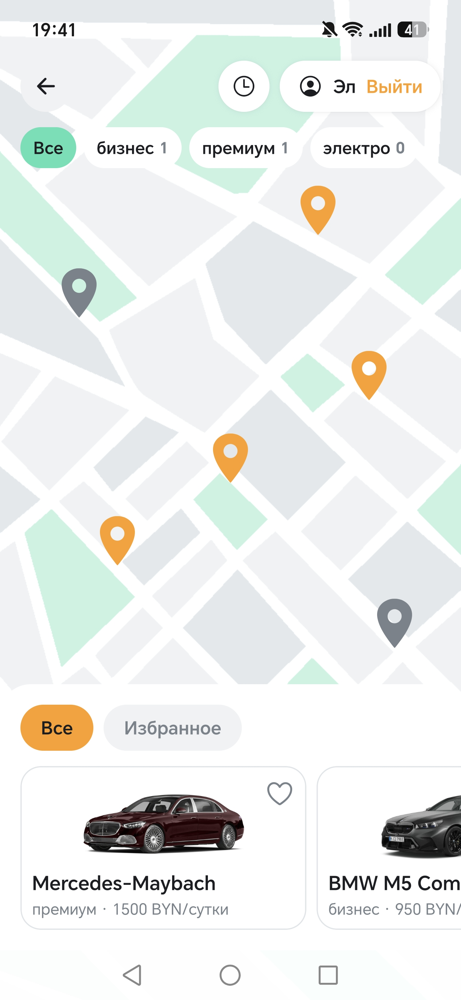
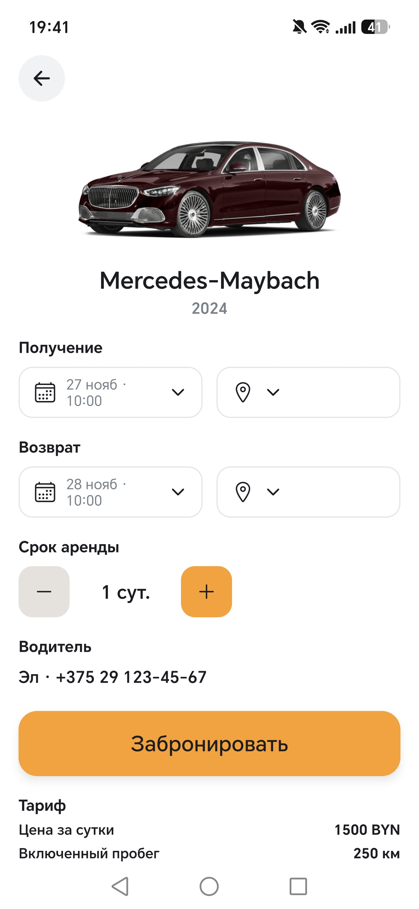
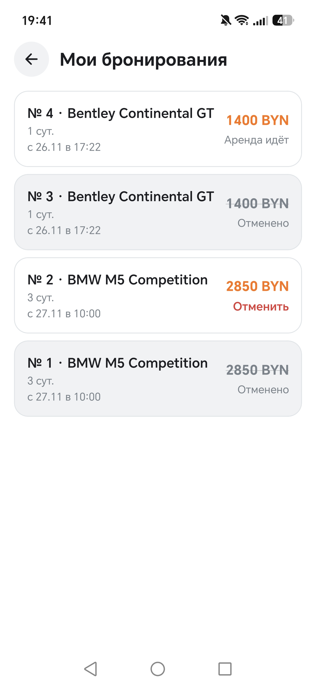

# Carsharing
Мобильное приложение на React Native + Expo

# Исходные данные

| Тема приложения | Обязательные экраны | Дополнительные требования |
| :--- | :--- | :--- |
| Каршеринг | Регистрация; карта с автомобилями; карточка автомобиля и бронирование | Всплывающая панель (Overlay) поверх экрана карты |

# Экраны приложения

| 01 Регистрация | 02 Карта с автомобилями | 03 Бронирование | 04 Мои бронирования |
| :---: | :---: | :---: | :---: |
|  |  |  |  |

# Структура проекта

```
Carsharing/
├── App.tsx                      – корневой компонент
├── types.ts                     – экраны навигатора и их параметры
├── theme.ts                     – цвета из таблицы стилей
├── api/
│   ├── client.ts                – адрес сервера и все запросы (GET, POST, PATCH)
│   └── types.ts                 – типы ответов сервера: Car, Booking, NewBooking, ClassStat
├── components/
│   ├── Button.tsx               – кнопка с вариантами primary / link
│   ├── FormField.tsx            – обёртка поля формы с текстом ошибки
│   ├── ErrorView.tsx            – ошибка загрузки с кнопкой «Повторить»
│   ├── CarCard.tsx              – крупная карточка автомобиля
│   ├── CarList.tsx              – карточка автомобиля в списке на карте
│   └── BackButton.tsx           – кнопка «Назад»
├── hooks/
│   ├── useFetch.ts              – загрузка с сервера: данные, загрузка, ошибка, повтор
│   └── useForm.ts               – значения полей, ошибки, отправка формы
├── contexts/
│   └── AuthContext.tsx          – вошедший пользователь (login / logout)
├── screens/
│   ├── RegistrationScreen.tsx   – 01 Регистрация
│   ├── MapCarsScreen.tsx        – 02 Карта с автомобилями, фильтр и статистика по классам, избранное
│   ├── CarOverlay.tsx           – всплывающая панель автомобиля
│   ├── BookingScreen.tsx        – 03 Карточка автомобиля и бронирование
│   └── BookingsScreen.tsx       – 04 Мои бронирования, отмена брони
├── assets/images/
│   └── map.png                  – карта
└── server/                      – сервер Express
    ├── server.js                – маршруты API на SQL, проверка данных, обработка ошибок
    ├── db.js                    – база SQLite: таблицы, ограничения, транзакция, начальные данные
    ├── data/cars.js             – начальные данные: каталог автомобилей
    ├── images/car1…car6.png     – изображения автомобилей
    ├── requests.http            – проверочные запросы для REST Client
    ├── package.json             – express, cors; скрипты dev / start
    └── carsharing.db            – файл базы, создаётся при первом запуске
```

## API

| Метод и путь | Что делает |
| :--- | :--- |
| `GET /api/cars?class=` | список автомобилей, фильтр по классу |
| `GET /api/cars/:id` | автомобиль по id |
| `POST /api/bookings` | создание брони; 409, если машина занята |
| `GET /api/bookings?phone=` | брони пользователя |
| `PATCH /api/bookings/:id` | отмена брони до начала аренды |
| `GET /api/stats/classes` | число активных броней по классам машин |

## Установка

Нужен Node.js 22.13 или новее

    git clone https://github.com/STKLMSH/Carsharing.git
    cd Carsharing
    npm install
    cd server
    npm install

## Запуск

Нужны два терминала.

**1. Сервер** 

    cd server
    npm run dev

При первом запуске создаётся база `carsharing.db` и в неё загружаются автомобили

**2. Приложение**

    npx expo start

В терминале появится QR-код:

- **Телефон** — отсканируйте QR-код камерой или из Expo Go
- **Браузер** — нажмите `w` в терминале или запустите `npm run web`
- **Эмулятор Android** — нажмите `a`

> Телефон и компьютер должны быть в одной Wi-Fi сети